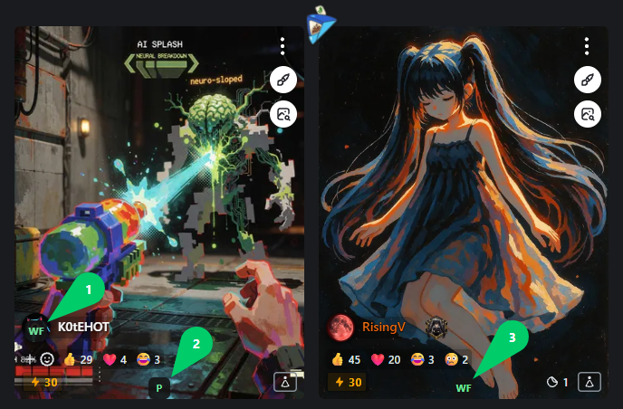
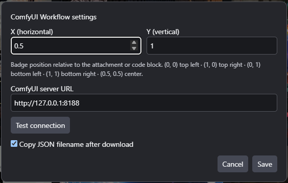
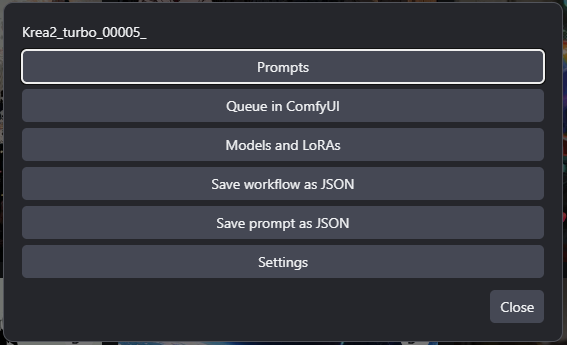
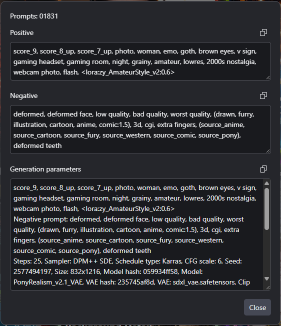
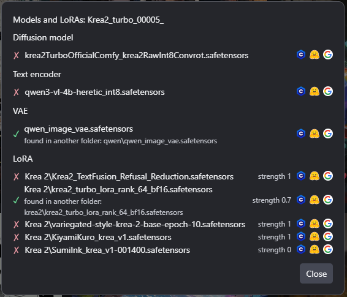

# ComfyUI Workflows

A Tampermonkey userscript for websites. It adds a **WF** badge for embedded [ComfyUI](https://github.com/Comfy-Org/ComfyUI) workflows and a **P** badge for prompt-only files.

<table>
  <tr>
    <td align="center">
      <br>
      <em>The WF badge marks an embedded workflow. The P badge marks an embedded prompt.</em>
    </td>
  </tr>
</table>

## Install

Open [Install in Tampermonkey](https://raw.githubusercontent.com/mr-asa/comfyui-workflows-tampermonkey/main/ComfyUIWorkflows.user.js), click **Install**, and reload the page you want to use it on.

Tampermonkey checks GitHub for updates. You can also run a manual update check from the Tampermonkey dashboard. To publish an update, increase the script's @version and push it to main.

YouTube, Netflix, Twitch, Disney+, Prime Video, Hulu, Max, and Spotify are excluded. The script skips HLS and DASH playlists and blob URLs. For other sites, you can add exclusions in Tampermonkey.

## Settings

Open **ComfyUI Workflow settings** from the Tampermonkey menu, or choose **Settings** from a badge. Changes apply to existing badges when saved.

Enter X and Y from 0 to 1. X increases rightward and Y increases downward, relative to the attachment or code block.

| X | Y | Position |
| --- | --- | --- |
| 0 | 0 | Top left |
| 1 | 0 | Top right |
| 0 | 1 | Bottom left |
| 1 | 1 | Bottom right |
| 0.5 | 0.5 | Center |

The default ComfyUI URL is `http://127.0.0.1:8188`. Use **Test connection** to check your URL. Tampermonkey may ask for permission to contact your configured server.

<table>
  <tr>
    <td align="center">
      <br>
      <em>Set the badge position and configure your ComfyUI server.</em>
    </td>
  </tr>
</table>

## Save to an absolute folder

Leave **JSON save folder** blank to use normal browser downloads. To save directly to a folder on Windows, run the helper with Python 3:

```powershell
py -3 save-workflows.py "D:\Workflows"
```

Keep the helper running, enter the same absolute folder in the userscript settings, and choose **Set save helper token** in the Tampermonkey menu. Paste the token shown in the terminal. The helper generates a new token each time it starts and only writes to its launch folder. Duplicate export names get a numbered suffix.

## Civitai generation parameters

A Civitai original image with embedded plain-text generation parameters gets a **P** badge. Open **Prompts** to view and copy the positive and negative prompts or the full parameters block. Queueing requires a ComfyUI API prompt.

## Imagus

Hover over a thumbnail to open the [Imagus](https://chromewebstore.google.com/detail/imagus/bdlicplmkecjmlefjndmgfgcdnilocio) or [Imagus Reborn](https://github.com/hababr/Imagus-Reborn) popup. The script checks the media URL shown in the popup and displays a badge if that file contains ComfyUI metadata.

## Badge actions

- View and copy positive and negative prompts.
- Queue API prompts in ComfyUI with model path matching and confirmation for quantization substitutions.
- Inspect model and LoRA availability and open model search links.
- Save workflow and prompt JSON. Settings can enable copying the filename.

<table>
  <tr>
    <td align="center">
      <br>
      <em>Open the badge menu to view prompts, inspect models, or save the workflow.</em>
    </td>
  </tr>
</table>

<table>
  <tr>
    <td align="center">
      <br>
      <em>View the prompt text and copy it with the icon on the right.</em>
    </td>
  </tr>
</table>

<table>
  <tr>
    <td align="center">
      <br>
      <em>Check which models and LoRAs are available and use the search icons to look them up.</em>
    </td>
  </tr>
</table>

The script checks original attachments for PNG, WebP, JPEG, MP4, WebM, MOV, MKV, M4V, FLAC, MP3, OGG, OPUS, M4A, WAV, and JSON. It also detects workflow JSON pasted in code blocks. Large audio and video use byte ranges. Discord may strip workflow metadata from re-encoded files.

Ported from the [BetterDiscord plugin](https://github.com/mr-asa/comfyui_workflow). See [LICENSE](LICENSE).
